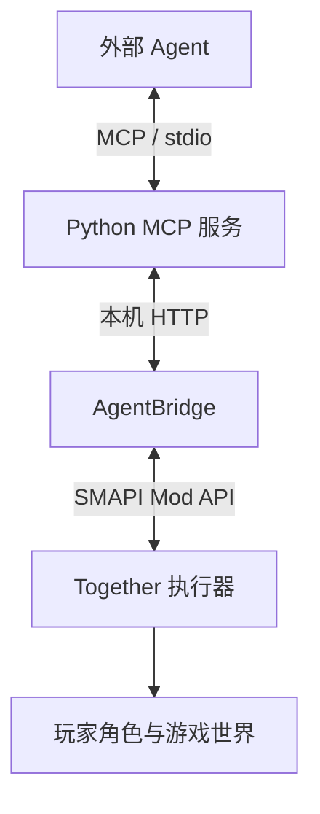

我们为游戏新露谷物语制作了原生支持的AI Agent 的MCP接入插件，为更多的游戏玩家提供极好的AI、agent接入体验，不管是直接帮你浇水、种菜、钓鱼，还是成为你的一个朋友，作为你的队友，陪伴你一起在星露谷物语游戏里面进行游玩，都拥有极佳的能力

游戏目录中的这一版叫 Stardew Hybrid。它复用了 [star](https://github.com/CSXizhang/star) 的八工具组织方式、目标存储和记忆模块，再接入[同行 Together](https://github.com/Zsh123456-BOOP/stardew-together) 的原生执行器。本文按本机这份整合代码说明，具体行为以 `.stardew-hybrid` 中的实现为准。

## 本地运行结构

启动脚本没有直接使用游戏根目录下的普通 `Mods`，而是把模组路径指向 `.stardew-hybrid/runtime/Mods`：

```powershell
& (Join-Path $gamePath 'StardewModdingAPI.exe') --mods-path $mods
```

这个运行目录中有 Together、AgentBridge 和所需的 TheStardewSquad 等模组。Python 则从 `launch_mcp.py` 进入 `stardew_hybrid/server.py`，通过标准输入输出提供 MCP 服务。

主要调用路径如下：



这里有两段通信。Agent 与 Python 服务之间使用 MCP；Python 与游戏之间使用自定义的 `/hybrid/*` HTTP 接口。后者负责传递状态、动作、控制权和回执，不是另一套 MCP 服务。[MCP 的架构说明](https://modelcontextprotocol.io/docs/learn/architecture)可以用来对照客户端、服务端与传输层的关系。

当前整合版把决策留给外部 Agent，游戏侧只保留一套实际执行路径。`PrepareHybridRuntime()` 会暂停 Together 原有的自动经营与内部模型循环，star 原版的游戏 Mod 和调度器也没有在这条路径中启动。

因此，连接 MCP 以后，仍需要 Agent 持续观察和安排工作。插件本身不会在对话停止后自动唤醒模型。游戏聊天也不会自动回传到这次外部 Agent 会话。

目录中的 `control.py` 是一个单次调用的 stdio 客户端。它用 `stdio_client` 和 `ClientSession` 包住一次请求，作用域结束后关闭连接；跨菜单的持续工作则依赖仍然存续的控制连接，连接清理可能触发释放或取消。

## 工具入口

服务对外保留八个名字：

| 入口 | 作用 |
| --- | --- |
| `get_status` | 查看连接、会话、玩家、控制权、目标和近期回执 |
| `query_game` | 执行命名查询，读取玩家快照或工作概览 |
| `submit_work` | 提交一项原生动作或规划请求 |
| `manage_arrangements` | 保存目标、更新进度，或管理暂停、恢复与控制权 |
| `remember` | 保存笔记、方法或用户答复 |
| `request_player_decision` | 返回需要用户回答的问题 |
| `consult` | 查看能力 Schema、检索记忆 |
| `read_reload_history` | 查看读档会话及历史重验信息 |

八个入口下面还可以有不同操作。例如，`manage_arrangements` 通过 `manage_goal` 管理目标，`consult` 通过 `inspect_capabilities` 查原生工具。这些操作名属于参数结构，不是又注册了一批同名顶层工具。

star 的 `game_tools.py` 用 Pydantic 动态生成参数模型，并要求一次只选一个命名操作：

```python
if sum(value is not None for value in self.__dict__.values()) != 1:
    raise ValueError("Choose exactly one named operation and its own parameter object")
```

下面是一份种植请求的结构示例。其中的会话、方案和目标编号都要来自当前查询结果：

```json
{
  "action": {
    "together_action": {
      "session_id": "<当前会话ID>",
      "tool": "work.run",
      "arguments": {
        "goal": "plant",
        "plan_id": "<选中的plan_id>"
      },
      "goal_id": "<外部目标ID>",
      "request_id": "<本次操作的唯一编号>"
    }
  }
}
```

外层的 `action.together_action` 交给 Python 适配器，`tool` 和 `arguments` 再交给游戏原生工具。一次调用的边界明确，后面才能分别判断它是规划、执行，还是等待用户处理菜单。

## 游戏状态和能力表

游戏状态直接从 SMAPI 与游戏对象读取。`ReadExternalPlayerState()` 访问 `Game1.player`、当前地图、背包与附近地块，整理出金钱、体力、工具槽位、作物和通行条件等字段。

例如，附近农地的状态来自真实的 `HoeDirt`：

```csharp
tilled=dirt!=null,
watered=dirt?.state.Value==1,
crop=dirt?.crop==null?null:new{
    harvest_id=dirt.crop.indexOfHarvest.Value,
    dead=dirt.crop.dead.Value,
    ready=dirt.readyForHarvest()
}
```

这部分不依赖截图判断土是不是湿的。截图可以辅助查看画面，作物是否存在、是否浇水与能否收获则有结构化状态可查。

Agent 也不能随便编一个工具名来调用。`HybridControl.cs` 从 Together 注册表挑出允许暴露的工具，生成名称、描述、参数 Schema 和分类，再对合同内容计算 `schema_hash`。

Python 在提交前按这份 Schema 检查参数：

```python
schema = spec["inputSchema"]
validator = validators.validator_for(schema)
validator.check_schema(schema)
validator(schema).validate(args)
```

游戏侧还会再检查一次，并要求请求中的 `schema_hash` 与当前合同相同。名字、字段或参数类型不匹配时，请求不会进入正常执行路径。

工具分类分为 `query`、`planning` 和 `action`。`farm.plan` 会产生可供后续引用的方案数据，因此经提交入口调用；它生成方案，却没有把种子种下。`goal.create` 也被要求使用 `run:false`，避免登记依赖目标时顺带启动另一套自动调度。

当前合同限制操作对象为真实玩家，伙伴专用批量能力与部分自动工作流没有开放。原生注册表里有某项能力，也不代表它一定被这层整合接口暴露。

## 主线程转发

AgentBridge 在本机回环地址接收 HTTP 请求，校验访问凭据后，把请求放进线程安全队列：

```csharp
var request = new Request(ctx.Request.HttpMethod, ctx.Request.Url!.AbsolutePath, ctx.Request.QueryString["actor_id"], body);
pending.Enqueue(request);
```

真正的处理放在 SMAPI 的 `UpdateTicked` 中：

```csharp
for (int n = 0; n < 8 && pending.TryDequeue(out var request); n++) {
    if (request.Result.Task.IsCanceled) continue;
    try { request.Result.TrySetResult(Process(request)); }
    catch (JsonException) { request.Result.TrySetResult(new(400, "{\"error\":\"invalid_json\"}")); }
    catch (Exception ex) { request.Result.TrySetResult(new(409, JsonSerializer.Serialize(new {error = ex.GetBaseException().Message}, Json))); }
}
```

网络线程负责收发，游戏对象的查询和派发回到主线程。每轮最多取八个请求，也给单次转发安排了上限。

这个队列存放的是等待游戏线程处理的接口请求。它与“保存一长串农活，日后自己重放”的工作队列不同：这版适配器没有持久化执行队列，持续任务由 Together 的原生执行器推进。

Python 桥接还限定目标为 `127.0.0.1`，关闭环境代理，不跟随 HTTP 重定向。访问桥接的凭据和后面控制角色的租约凭据分别处理，公开状态会去掉这些私密字段。

## 农务执行

种植先经过 `farm.plan`。规划读取已持有种子、可耕地、已有作物、灌溉与通路，返回带 `plan_id` 的候选。Agent 选中方案以后，再调用 `work.run` 的 `plant` 目标。

`work.run` 创建的是有边界的持续工作，保留目标、位置、完成数量、当前阶段和原生子动作编号。数量、体力预留与截止时间会参与检查，执行过程中再选择下一项具体工作。

这些子动作在游戏中连续推进，不需要模型为每一格移动、每一次挥锄重新发请求。Together 中的 `PlayerExecutor` 负责走到工作站位、选工具、朝向目标、触发动作和核对结果。

工具操作走玩家原生方法：

```csharp
Game1.player.lastClick=tile.ToVector2()*64+new Vector2(32);
Game1.player.BeginUsingTool();
if(!Game1.player.UsingTool)throw new InvalidOperationException("work_tool_not_started");
```

种植则调用原生放置逻辑，并检查种子是否真正减少：

```csharp
int beforeStack=Game1.player.Items.Where(i=>i?.QualifiedItemId==seed.QualifiedItemId).Sum(i=>i.Stack);
if(!Utility.tryToPlaceItem(Game1.currentLocation,seed,tile.X*64,tile.Y*64))throw new InvalidOperationException("native_plant_rejected");
if(beforeStack-Game1.player.Items.Where(i=>i?.QualifiedItemId==seed.QualifiedItemId).Sum(i=>i.Stack)!=1)throw new InvalidOperationException("native_seed_or_fertilizer_consumption_not_verified");
```

之后还要等工具动作完成，再比较目标地块的前后状态：

```csharp
var after=TileState(tile);
if(JsonSerializer.Serialize(workBefore)==JsonSerializer.Serialize(after))throw new InvalidOperationException("work_effect_not_observed");
Current.effects.Add(new{before=workBefore,after,work_skill=workSkill,work_slot=workSlot});
```

已经浇过水的地块可以跳过；缺水、种子不在、站位发生变化等情况，则会影响当前工作。完成数量来自执行过程中观察到的进度。

移动同样保留原生速度与碰撞。`PlayerRouteController` 继承游戏的寻路控制器，必要时尝试局部避让，再调用玩家的移动方法。执行器会检查当前位置和剩余路线，换地图后也不会继续使用旧地图上的控制器。

## 动作回执

提交成功与动作完成分别返回。持续动作拿到 `command_id` 后，Python 适配器按这个编号等待原生结果，默认轮询间隔为 0.2 秒。

原生结果区分 `succeeded`、`failed`、`partial`、`cancelled`、`unknown` 等状态。`blocked` 也单独处理，用来说明当前条件没有满足。接到受理响应或看到角色开始走路，都还不能据此写“已经种完”。

`HybridRuntime.action()` 在派发前先保存请求与目标的关系：

```python
self.store.bind_request(identity,rid,tool,arguments,goal_id=goal_id)
self._request_goals[association]=goal_id
envelope=await self.bridge.execute(tool,arguments,session_id=session_id,request_id=rid);self._start_heartbeat()
```

回执回来以后，记录里带有原生命令编号、会话、存档、角色、请求和目标来源。游戏动作成功时，接口仍保留 `goal_completion: None`，把“这个动作做完了”与“用户目标已完成”分开。

比如一次浇水只处理了部分田地，Agent 还需要看剩余作物、水壶容量和体力，再决定继续浇、补水或调整安排。计划生成、记下一条方法、登记一个目标，都不会产生已经执行农活的证据。

## 请求编号与重试

游戏可能已经执行了请求，但返回消息在途中丢失。此时如果换一个新编号重发，同一件事就可能发生第二遍。

这一版用 `request_id` 标记一次确定的意图，同时把工具名与规范化参数保存下来。游戏侧检查到同一个编号时，走已有结果：

```csharp
string canonical=tool+":"+CanonicalHybrid(args);
if(hybridRequests.TryGetValue(requestId,out var old)) {
    if(old.Canonical!=canonical)throw new InvalidOperationException("request_id_conflict");
    return HybridEnvelope(tool,requestId,old.CommandId,old.CommandId==null?old.Result:HybridReceipt(old.CommandId,false),true);
}
```

参数中的对象键会排序后再比较。键的书写顺序改变，不会凭空变成另一项动作；同一个编号被拿去调用不同工具或传入不同参数，则被拒绝。

Python 遇到写入结果不确定时，会尝试从原请求与原生回执恢复结果。无法确认就继续保留不确定状态，不自动创建新动作。持久化的 `bind_request()` 还保存参数摘要与外部目标，防止重连以后把原动作的证据挂到另一个目标上。

这里有两种不同的目标编号。外层 `goal_id` 是 Python 保存的用户目标，`arguments.goal_id` 如果出现，则属于 Together 的原生依赖目标。它们在不同模块中查找，不能互相替代。

## 控制权与接管

控制真实主角需要独占控制权。`ExternalControlGate` 保存当前拥有者、私密租约令牌、到期时间和正在执行的动作编号。领取与续期都要经过这道检查，旧接口也受相同控制状态约束。

租约有期限，Python 运行时每 20 秒尝试续期。旧动作还在执行或收尾时，新控制方不能直接领取角色；租约失效后，原生维护逻辑会要求停止相应工作。

玩家按 F10，或使用已映射的游戏输入，可以接管。核心处理如下：

```csharp
public string? Takeover()
{
    lock (sync)
    {
        humanLocked = true;
        ClearLease();
        return activeActionId;
    }
}
```

控制权立即失效，当前动作随后进入取消流程。`humanLocked` 会持续保留，即便原动作已经结束，Agent 也不能自行领回角色。玩家再按 F10，才允许它重新申请。

取消也保留了原生动作的收尾条件。工具已经挥下时可能先完成这次作用；已经确认的过夜保存也允许继续完成。取消停止的是后续执行，先前播下的种子和消耗的资源不会回滚。

F8 打开的 `HybridStatusMenu` 用于查看当前工作。面板打开时，常规执行暂时停下；通过 MCP 发起的操作不能替玩家关闭这个检查面板，需要等玩家自行关闭后继续。

## 目标和记忆

Python 持久层复用了 star 的工作状态与记忆存储，主要文件是 `work-state.json`、`companion-memory.json` 和 `hybrid-metadata.json`。

目标按存档与 Farmer 身份隔离，私人笔记再加一层 `agent_id`。因此，同一存档里的不同角色不会混用目标，不同 Agent 的私人笔记也分别检索。

保存方法时，返回值明确保留：

```python
return _copy(dict(result, status=status, execution='not_started'))
```

方法和偏好是后续决策的参考，不会因为保存了一段文字就开始劳动。历史记录里的库存、浇水和收获情况，也要与当前游戏状态分开使用。

标记目标完成需要显式提交证据编号。代码要求证据属于当前会话、对应当前目标，并且原生结果为成功；随后把完成判断标成 `agent_assessed`。

这仍然需要 Agent 判断用户要求是否全部满足。存储层能检查回执的来源和状态，却没有替自然语言目标建立一个通用的自动判定器。只有一份成功回执，也不代表整片田已经处理完。

文件更新使用线程锁、跨进程文件锁和临时文件替换。读到损坏的数据时会报错，避免把无法解析的旧目标和记忆当作空白状态覆盖。

## 读档与跨日

新建、加载存档或回到标题画面时，AgentBridge 会更新 `session_id`，清理本轮请求缓存，并通知原生控制层重置会话。

动作请求必须携带观察到的当前会话：

```csharp
if(HybridString(root,"session_id")!=hybridGate.Status.SessionId)throw new InvalidOperationException("stale_session");
```

Python 一侧也做相同核对，不会把请求中旧的会话编号替换成新的继续执行。读档后的坐标、背包和作物可能已经不同，需要重新观察。

历史完成目标会保留，但如果完成证据来自另一轮会话，就附加 `needs_revalidation`。这只是要求重新核验，不会自动恢复旧执行队列或重放以前的动作。

过夜则需要延续同一条原生命令。保存、结算或菜单过渡时，世界可能暂时不满足普通操作条件，接口会标注缓存快照，避免把上一次背包当成当前库存。

遇到仍需外部选择的菜单，适配器返回 `waiting_for_menu`，把菜单状态交回 Agent。Agent 读取选项后，通过菜单工具继续原来的动作；最终还要核对保存发生、日期前进和角色恢复可动，才结束睡眠流程。

`request_player_decision` 用来把需要用户决定的问题带回原 Agent 对话，返回的是待回答状态。保存用户答复以后，也还需要另行提交对应的原生操作。

## 源码入口

这份本机整合的主要实现可以从下面几个位置继续看。路径均相对于 `.stardew-hybrid`：

| 位置 | 内容 |
| --- | --- |
| `src/stardew_hybrid/server.py` | MCP 服务、工具注册、动作等待、目标与记忆入口 |
| `src/stardew_hybrid/bridge.py` | 本机 HTTP、Schema 校验、控制租约和不确定请求恢复 |
| `src/stardew_hybrid/state.py` | 目标、笔记、请求绑定、回执与会话历史 |
| `upstreams/star/runtime/src/stardew_ai_runtime/game_tools.py` | 八工具包装与单操作参数模型 |
| `src/together/mod/AgentBridge/ModEntry.cs` | HTTP 接收、请求队列与游戏主线程转发 |
| `src/together/mod/Together/HybridControl.cs` | 原生能力合同、派发、回执与接管处理 |
| `src/together/mod/Together/ExternalControlGate.cs` | 独占控制权与租约状态 |
| `src/together/mod/Together/PlayerExecutor.cs` | 玩家原生动作、农务效果与过夜核验 |
| `src/together/mod/Together/SemanticWork.cs` | 持续工作及其原生子动作 |
| `src/together/mod/Together/HybridStatusMenu.cs` | 游戏内状态面板 |

当前运行范围集中在单人存档的真实主角。Together 仍依赖 TheStardewSquad，但这不表示整合版自动启用了独立伙伴或多人协作。源码中的能力还受材料、地图、解锁条件和具体适配范围限制。

随附说明将隔离 AgentLab 中的播种、浇水、过夜等验收，与个人存档连接检查分开记录；高级能力也没有被宣称全部完成长程实机验收。阅读源码中的工具列表时，应结合这份实际范围。

star 的固定源码与 Apache-2.0 许可证保留在 `upstreams/star`，Together 的本地修改位于 `src/together`。旧 `.stardew-together` 目录留作回退基线，当前启动路径、配置和融合数据则集中在 `.stardew-hybrid`。
