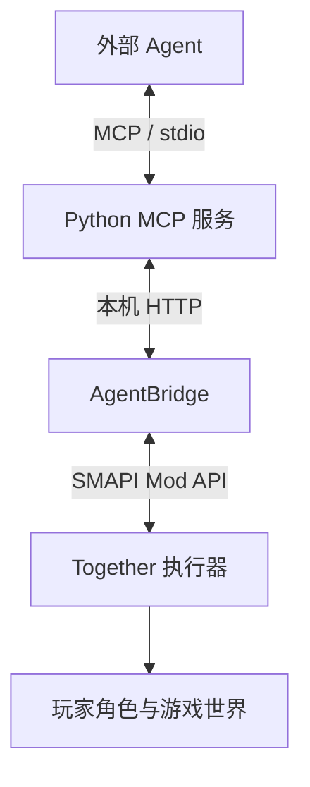

We built a natively supported MCP integration for AI agents in Stardew Valley, giving more players a way to bring AI and agents into the game. Whether helping water crops, plant seeds, and fish, or becoming a friend and teammate who accompanies you through Stardew Valley, it offers a wide range of possibilities.

The version in the game directory is called Stardew Hybrid. It reuses [star](https://github.com/CSXizhang/star)'s eight-tool organization, goal storage, and memory modules, then connects them to the native executor from [Together](https://github.com/Zsh123456-BOOP/stardew-together). This article describes the integrated code on this machine; the implementation in `.stardew-hybrid` determines its actual behavior.

## Local runtime structure

The launch script does not use the ordinary `Mods` directory at the game root. Instead, it points the mod path to `.stardew-hybrid/runtime/Mods`:

```powershell
& (Join-Path $gamePath 'StardewModdingAPI.exe') --mods-path $mods
```

This runtime directory contains Together, AgentBridge, and required mods such as TheStardewSquad. On the Python side, `launch_mcp.py` enters `stardew_hybrid/server.py`, which provides an MCP service over standard input and output.

The main call path is:



There are two communication segments. The agent and Python service use MCP; Python and the game use custom `/hybrid/*` HTTP endpoints. The latter carry state, actions, control ownership, and receipts; they are not a second MCP service. The [MCP architecture documentation](https://modelcontextprotocol.io/docs/learn/architecture) provides a reference for the relationships between clients, servers, and transport layers.

The current integration leaves decisions to an external agent and retains a single execution path in the game. `PrepareHybridRuntime()` pauses Together's original automatic management and internal model loop. The original star game mod and scheduler are not started on this path either.

Connecting MCP therefore still requires the agent to keep observing and arranging work. The plugin does not automatically wake the model after a conversation stops. In-game chat is not automatically forwarded to this external agent session either.

The directory's `control.py` is a one-shot stdio client. It wraps one request in `stdio_client` and `ClientSession`, then closes the connection when that scope ends. Work that continues across menus depends on a control connection that remains alive; connection cleanup can trigger release or cancellation.

## Tool entry points

The service exposes eight names:

| Entry point | Purpose |
| --- | --- |
| `get_status` | Inspect the connection, session, player, control ownership, goals, and recent receipts |
| `query_game` | Run a named query to read a player snapshot or work overview |
| `submit_work` | Submit a native action or planning request |
| `manage_arrangements` | Save goals, update progress, or manage pausing, resuming, and control ownership |
| `remember` | Save notes, methods, or user answers |
| `request_player_decision` | Return a question that needs the user's answer |
| `consult` | Inspect capability schemas and retrieve memories |
| `read_reload_history` | Read save-loading sessions and historical revalidation information |

Each of these entry points can contain different operations. For example, `manage_arrangements` manages goals through `manage_goal`, while `consult` inspects native tools through `inspect_capabilities`. These operation names belong to parameter structures; they are not another set of top-level tools registered under those names.

star's `game_tools.py` generates parameter models dynamically with Pydantic and requires exactly one named operation per call:

```python
if sum(value is not None for value in self.__dict__.values()) != 1:
    raise ValueError("Choose exactly one named operation and its own parameter object")
```

The following example shows the structure of a planting request. Its session, plan, and goal identifiers must come from current query results:

```json
{
  "action": {
    "together_action": {
      "session_id": "<当前会话ID>",
      "tool": "work.run",
      "arguments": {
        "goal": "plant",
        "plan_id": "<选中的plan_id>"
      },
      "goal_id": "<外部目标ID>",
      "request_id": "<本次操作的唯一编号>"
    }
  }
}
```

The outer `action.together_action` goes to the Python adapter; `tool` and `arguments` then go to the game's native tools. Keeping one call's boundary explicit makes it possible to distinguish planning, execution, and waiting for the user to handle a menu.

## Game state and the capability catalog

Game state is read directly from SMAPI and game objects. `ReadExternalPlayerState()` accesses `Game1.player`, the current map, inventory, and nearby tiles, organizing fields such as money, stamina, tool slots, crops, and traversal conditions.

For example, nearby farmland state comes from actual `HoeDirt` objects:

```csharp
tilled=dirt!=null,
watered=dirt?.state.Value==1,
crop=dirt?.crop==null?null:new{
    harvest_id=dirt.crop.indexOfHarvest.Value,
    dead=dirt.crop.dead.Value,
    ready=dirt.readyForHarvest()
}
```

This does not rely on screenshots to decide whether soil is wet. Screenshots can help inspect the scene, while structured state indicates whether a crop exists, has been watered, or is ready to harvest.

The agent also cannot invent a tool name and call it. `HybridControl.cs` selects tools allowed to be exposed from Together's registry, generates their names, descriptions, parameter schemas, and categories, and computes a `schema_hash` for that contract.

Python validates parameters against this schema before submission:

```python
schema = spec["inputSchema"]
validator = validators.validator_for(schema)
validator.check_schema(schema)
validator(schema).validate(args)
```

The game checks them again and requires the request's `schema_hash` to match the current contract. A request with a mismatched name, field, or parameter type does not enter the normal execution path.

Tools are categorized as `query`, `planning`, and `action`. `farm.plan` produces plan data that later calls can reference, so it is invoked through the submission entry point. It generates a plan without planting seeds. `goal.create` is also required to use `run:false`, avoiding the accidental start of another automatic scheduler when registering a dependency goal.

The current contract limits operations to the actual player. Companion-specific batch capabilities and some automatic workflows are not exposed. A capability appearing in the native registry does not mean this integration layer necessarily exposes it.

## Forwarding to the main thread

AgentBridge receives HTTP requests on the local loopback address, validates access credentials, and puts requests into a thread-safe queue:

```csharp
var request = new Request(ctx.Request.HttpMethod, ctx.Request.Url!.AbsolutePath, ctx.Request.QueryString["actor_id"], body);
pending.Enqueue(request);
```

Actual processing happens inside SMAPI's `UpdateTicked` event:

```csharp
for (int n = 0; n < 8 && pending.TryDequeue(out var request); n++) {
    if (request.Result.Task.IsCanceled) continue;
    try { request.Result.TrySetResult(Process(request)); }
    catch (JsonException) { request.Result.TrySetResult(new(400, "{\"error\":\"invalid_json\"}")); }
    catch (Exception ex) { request.Result.TrySetResult(new(409, JsonSerializer.Serialize(new {error = ex.GetBaseException().Message}, Json))); }
}
```

The network thread handles receiving and sending; game-object queries and dispatch return to the main thread. Each round takes at most eight requests, placing a limit on a single forwarding batch.

This queue holds interface requests waiting for the game thread to process them. It differs from a work queue that saves a long list of farm tasks and replays them later: this adapter has no persistent execution queue. Together's native executor advances continuing tasks.

The Python bridge also restricts its destination to `127.0.0.1`, disables environment proxies, and does not follow HTTP redirects. Credentials for accessing the bridge are handled separately from lease credentials for controlling a character; public status removes these private fields.

## Executing farm work

Planting first goes through `farm.plan`. Planning reads seeds already held, tillable land, existing crops, irrigation, and paths, then returns candidates with a `plan_id`. After the agent selects a plan, it calls the `plant` goal of `work.run`.

`work.run` creates bounded continuing work, retaining the goal, location, completed count, current stage, and native sub-action identifier. Quantity, stamina reserve, and deadline are checked, and the next concrete task is selected during execution.

These sub-actions advance continuously in the game. The model does not need to send a new request for every tile of movement or every swing of the hoe. Together's `PlayerExecutor` moves to the work position, selects a tool, faces the target, triggers the action, and verifies its result.

Tool use follows the player's native methods:

```csharp
Game1.player.lastClick=tile.ToVector2()*64+new Vector2(32);
Game1.player.BeginUsingTool();
if(!Game1.player.UsingTool)throw new InvalidOperationException("work_tool_not_started");
```

Planting calls native placement logic and checks that the seed count really decreased:

```csharp
int beforeStack=Game1.player.Items.Where(i=>i?.QualifiedItemId==seed.QualifiedItemId).Sum(i=>i.Stack);
if(!Utility.tryToPlaceItem(Game1.currentLocation,seed,tile.X*64,tile.Y*64))throw new InvalidOperationException("native_plant_rejected");
if(beforeStack-Game1.player.Items.Where(i=>i?.QualifiedItemId==seed.QualifiedItemId).Sum(i=>i.Stack)!=1)throw new InvalidOperationException("native_seed_or_fertilizer_consumption_not_verified");
```

It then waits for the tool action to finish and compares the target tile's state before and after:

```csharp
var after=TileState(tile);
if(JsonSerializer.Serialize(workBefore)==JsonSerializer.Serialize(after))throw new InvalidOperationException("work_effect_not_observed");
Current.effects.Add(new{before=workBefore,after,work_skill=workSkill,work_slot=workSlot});
```

Already-watered tiles can be skipped. Conditions such as an empty watering can, unavailable seeds, or a changed work position affect the current task. Completed counts come from progress observed during execution.

Movement also retains native speed and collision. `PlayerRouteController` extends the game's pathfinding controller, attempts local avoidance when needed, and calls the player's movement methods. The executor checks the current position and remaining route, and does not continue using an old map's controller after changing maps.

## Action receipts

Successful submission and completed execution are returned separately. After a continuing action receives a `command_id`, the Python adapter waits for the native result by that identifier, polling every 0.2 seconds by default.

Native results distinguish states including `succeeded`, `failed`, `partial`, `cancelled`, and `unknown`. `blocked` is handled separately to indicate unmet conditions. Receiving an accepted response or seeing the character start walking is not enough to report that planting has finished.

`HybridRuntime.action()` records the relationship between a request and its goal before dispatch:

```python
self.store.bind_request(identity,rid,tool,arguments,goal_id=goal_id)
self._request_goals[association]=goal_id
envelope=await self.bridge.execute(tool,arguments,session_id=session_id,request_id=rid);self._start_heartbeat()
```

When the receipt returns, the record contains the native command identifier, session, save, character, request, and goal origin. Even when a game action succeeds, the interface retains `goal_completion: None`, separating “this action finished” from “the user's goal is complete.”

For example, if watering only covers part of a field, the agent still needs to inspect the remaining crops, watering-can capacity, and stamina before deciding whether to continue, refill, or adjust the arrangement. Generating a plan, recording a method, or registering a goal provides no evidence that farm work has actually been performed.

## Request identifiers and retries

The game may have executed a request even if its reply was lost in transit. Resending with a new identifier could make the same action happen twice.

This version uses `request_id` to mark one specific intent and stores the tool name with normalized arguments. When the game sees the same identifier again, it uses the existing result:

```csharp
string canonical=tool+":"+CanonicalHybrid(args);
if(hybridRequests.TryGetValue(requestId,out var old)) {
    if(old.Canonical!=canonical)throw new InvalidOperationException("request_id_conflict");
    return HybridEnvelope(tool,requestId,old.CommandId,old.CommandId==null?old.Result:HybridReceipt(old.CommandId,false),true);
}
```

Object keys in the arguments are sorted before comparison. Changing key order does not turn the request into a different action. Reusing the same identifier with a different tool or different arguments is rejected.

When Python is uncertain about a write's result, it attempts recovery through the original request and native receipt. If it cannot confirm the outcome, it keeps that uncertainty rather than automatically creating another action. Persistent `bind_request()` also saves the argument digest and external goal, preventing reconnection from attaching the original action's evidence to another goal.

There are two different kinds of goal identifier here. The outer `goal_id` is the user goal stored by Python; `arguments.goal_id`, when present, belongs to Together's native dependency goals. They are looked up in different modules and cannot substitute for one another.

## Control ownership and player takeover

Controlling the real protagonist requires exclusive control ownership. `ExternalControlGate` stores the current owner, private lease token, expiry time, and active action identifier. Acquiring and renewing control pass through this check, and older interfaces are subject to the same control state.

The lease expires, and the Python runtime attempts renewal every 20 seconds. While an old action is still executing or finishing cleanup, a new controller cannot simply claim the character. After lease expiry, native maintenance requests that the corresponding work stop.

The player can take over by pressing F10 or using a mapped game input. The core handling is:

```csharp
public string? Takeover()
{
    lock (sync)
    {
        humanLocked = true;
        ClearLease();
        return activeActionId;
    }
}
```

Control ownership becomes invalid immediately, and the active action then enters cancellation. `humanLocked` remains in effect even after that action ends, so the agent cannot reclaim the character on its own. Another F10 press by the player allows it to apply again.

Cancellation retains the cleanup conditions of native actions. A tool already swinging may complete its current effect, and an already-confirmed overnight save is allowed to finish. Cancellation stops subsequent execution; it does not roll back seeds already planted or resources already consumed.

F8 opens `HybridStatusMenu` to inspect current work. Ordinary execution pauses while the panel is open. MCP operations cannot close this inspection panel on the player's behalf; execution must wait for the player to close it.

## Goals and memory

Python's persistence layer reuses star's work-state and memory storage. Its main files are `work-state.json`, `companion-memory.json`, and `hybrid-metadata.json`.

Goals are isolated by save and Farmer identity; private notes add another `agent_id` boundary. Different characters in one save therefore do not mix goals, and different agents retrieve their private notes separately.

When saving a method, the returned value explicitly retains:

```python
return _copy(dict(result, status=status, execution='not_started'))
```

Methods and preferences are references for later decisions. Saving text does not start work. Historical records of inventory, watering, and harvests must also be kept distinct from the current game state.

Marking a goal complete requires explicitly submitting evidence identifiers. The code requires evidence from the current session, associated with the current goal, and backed by a successful native result. It then labels the completion judgment `agent_assessed`.

The agent must still judge whether the user's requirements have all been met. Storage can check a receipt's origin and status, but it does not provide a general automatic evaluator for natural-language goals. One successful receipt does not establish that an entire field has been handled.

File updates use thread locks, cross-process file locks, and temporary-file replacement. Corrupted data produces an error rather than allowing unreadable old goals and memories to be treated as empty state and overwritten.

## Reloading saves and crossing days

When creating or loading a save or returning to the title screen, AgentBridge updates `session_id`, clears this round's request cache, and tells the native control layer to reset the session.

Action requests must carry the currently observed session:

```csharp
if(HybridString(root,"session_id")!=hybridGate.Status.SessionId)throw new InvalidOperationException("stale_session");
```

Python performs the same check. It does not replace an old session identifier with a new one and continue executing. Coordinates, inventory, and crops may differ after a reload, so they must be observed again.

Completed historical goals remain, but evidence from another session receives `needs_revalidation`. This only requests another check; it does not automatically restore an old execution queue or replay earlier actions.

Going to bed must continue the same native command. During saving, settlement, or menu transitions, the world may temporarily be unavailable for ordinary operations. The interface labels cached snapshots so the previous inventory is not mistaken for the current one.

When a menu still requires an external choice, the adapter returns `waiting_for_menu` and passes the menu state back to the agent. After reading the options, the agent uses menu tools to continue the original action. The sleep flow ends only after checking that saving occurred, the date advanced, and the character can move again.

`request_player_decision` brings questions requiring a user decision back to the original agent conversation and returns a waiting-for-answer state. Even after saving the user's reply, the corresponding native operation must be submitted separately.

## Source code entry points

The main implementation of this local integration can be explored at the following locations. All paths are relative to `.stardew-hybrid`:

| Location | Contents |
| --- | --- |
| `src/stardew_hybrid/server.py` | MCP service, tool registration, action waiting, and goal/memory entry points |
| `src/stardew_hybrid/bridge.py` | Local HTTP, schema validation, control leases, and uncertain-request recovery |
| `src/stardew_hybrid/state.py` | Goals, notes, request bindings, receipts, and session history |
| `upstreams/star/runtime/src/stardew_ai_runtime/game_tools.py` | Eight-tool wrappers and single-operation parameter models |
| `src/together/mod/AgentBridge/ModEntry.cs` | HTTP reception, the request queue, and forwarding to the game's main thread |
| `src/together/mod/Together/HybridControl.cs` | Native capability contracts, dispatch, receipts, and takeover handling |
| `src/together/mod/Together/ExternalControlGate.cs` | Exclusive control ownership and lease state |
| `src/together/mod/Together/PlayerExecutor.cs` | Native player actions, farm-effect checks, and overnight verification |
| `src/together/mod/Together/SemanticWork.cs` | Continuing work and its native sub-actions |
| `src/together/mod/Together/HybridStatusMenu.cs` | In-game status panel |

The current runtime focuses on the real protagonist in a single-player save. Together still depends on TheStardewSquad, but that does not mean this integration automatically enables independent companions or multiplayer cooperation. Capabilities in the source remain constrained by materials, maps, unlock conditions, and the scope of each adapter.

The accompanying notes record planting, watering, and overnight acceptance checks in the isolated AgentLab separately from personal-save connection checks. They also do not claim that every advanced capability has completed long-running in-game acceptance testing. Read the tool list in the source in light of that actual scope.

star's pinned source and Apache-2.0 license remain in `upstreams/star`, while local Together changes are in `src/together`. The old `.stardew-together` directory is retained as a rollback baseline; the current launch path, configuration, and combined data are concentrated in `.stardew-hybrid`.
